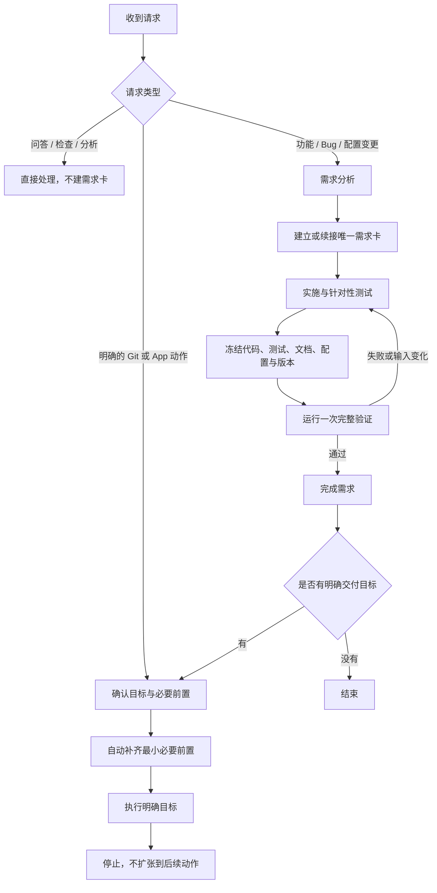

# iOS TeamFlow

面向 Codex 驱动开发的中文 iOS 工作流，覆盖需求分析、需求跟踪、实施、验证与显式交付。当前版本为 **3.1.2**。

工作流以一张需求卡作为当前变更的事实源。问答和只读检查直接处理；开发变更进入需求流程；Git、TestFlight、App Store 等外部动作只有在目标被明确指出时才执行。

## 工作流结构



核心执行顺序固定为：

```text
完成全部改动 → 环境预检 → 针对性测试 → 文件冻结 → 一次完整验证 → 目标交付
```

“一次完整验证”指正常成功路径只运行一次最终 profile。验证失败，或验证后的受跟踪输入发生变化时，证据失效，必须修复、重新冻结并再次验证。

## 分层结构

| 层级 | 位置 | 职责 |
| --- | --- | --- |
| 项目入口 | `AGENTS.md` | 声明 Skill、项目空间、验证顺序和外部动作边界 |
| 工作流入口 | `.agents/skills/ios-team-flow/SKILL.md` | 根据当前任务路由需要读取的专题 |
| 主流程 | `references/WORKFLOW.md` | 定义请求识别、需求跟踪、实施验证和停止条件 |
| 专题规则 | `references/*.md` | 按需提供架构、测试、多语言、Git、App 发布和语言/UI 规范 |
| 执行工具 | `scripts/teamflow.py` | 创建需求、查询状态、运行验证和执行提交前检查 |
| 项目配置 | `.agents/project-checks.json` | 保存真实构建、测试命令以及 profile 输入范围 |
| 过程记录 | `requirements/` | 保存需求范围、AC、状态与验证证据 |
| 验证证据 | `logs/project-checks/` | 保存命令、退出状态、日志和输入指纹 |

详细主流程见 [WORKFLOW](.agents/skills/ios-team-flow/references/WORKFLOW.md)。

## 核心规则

- 每个开发变更只维护一张需求卡；范围、不包含内容、AC、状态和验证证据不在其他文件重复维护。
- 问答、审计、建议和只读检查不创建需求卡。
- 开发期间运行最小相关测试；所有改动完成并冻结后，再运行匹配范围的完整 profile。
- 完成需求不自动触发 commit、push、标签、Release 或任何 App 外部动作。
- 明确目标动作后，可自动补齐该目标不可缺少的前置步骤，但不执行可选配置、相邻动作或目标之后的动作。
- App 用户可见文本必须来自本地化资源，键采用按实际语义层级伸缩的点分格式；至少两段但不固定为三段。
- 普通 TestFlight 上传省略 `testFlightInternalTestingOnly`；只有明确要求 TestFlight Internal Only 时才设为 `true`。

## 安装

环境需要 Python 3.10+、Git，以及业务 App 对应的 macOS/Xcode。将完整 Skill 放入项目：

```text
.agents/skills/ios-team-flow/
```

从项目 Git 根执行：

```sh
python3 .agents/skills/ios-team-flow/scripts/setup_project.py --project .
```

接入脚本会生成 `AGENTS.md` 托管区块、`.agents/teamflow.json` 和 `scripts/teamflow.py`，并创建 `requirements/`。3.0.0 起使用断代格式，不迁移旧需求卡、delivery、review receipt 或旧 CLI。

## 需求流程

1. 识别请求：区分只读处理、开发变更与显式外部动作。
2. 分析需求：明确范围、不包含内容和可观察 AC；只有影响结果且无法安全推断的选择才进入待确认。
3. 跟踪进度：创建或续接唯一需求卡，通过状态和 AC 图标反映进展。
4. 实施与验证：完成改动、环境预检、针对性测试、文件冻结和完整验证。
5. 完成需求：绑定通过的验证证据；需要实际确认时进入待用户验证。
6. 执行交付：仅在目标明确时进入对应 Git 或 App 模块，并在目标完成后停止。

## 状态与进度

需求卡和需求列表使用同一套彩色状态与进度图标：

| 图标 | 状态 | 含义 |
| --- | --- | --- |
| ⚪ | 待处理 | 已记录，尚未开始 |
| 🟡 | 待确认 | 等待必要业务选择 |
| 🔵 | 进行中 | 正在分析、实施或验证 |
| 🟣 | 待用户验证 | 自动验证完成，等待实际确认 |
| ✅ | 完成 | AC 与适用验证均已完成 |
| 🔴 | 阻塞 | 因外部条件无法继续 |
| 🟠 | 暂停 | 已明确暂停 |
| ⚫ | 取消 | 已明确取消 |

AC 行不使用复选框：`⚪ AC-xx` 表示未完成，`✅ AC-xx` 表示完成。需求列表使用 `⚪ 0/N`、`🔵 M/N` 和 `✅ N/N` 显示整体进度。

## 常用命令

```sh
# 创建功能需求或 Bug
python3 scripts/teamflow.py req create --title "登录失败提示优化"
python3 scripts/teamflow.py req create --bug --title "修复重复请求"

# 查看需求列表和单张需求
python3 scripts/teamflow.py req list
python3 scripts/teamflow.py req status REQ-0001

# 运行项目配置中的完整验证 profile
python3 scripts/teamflow.py verify run --profile change

# AC 完成后绑定验证结果
python3 scripts/teamflow.py req complete REQ-0001 \
  --result logs/project-checks/运行编号/result.json

# commit 前核对暂存对象与验证证据
python3 scripts/teamflow.py git check REQ-0001 \
  --result logs/project-checks/运行编号/result.json
```

## 显式交付边界

| 明确目标 | 自动补齐的必要前置 | 不自动执行 |
| --- | --- | --- |
| commit | 暂存本次范围、提交检查 | push、标签、Release |
| push | 验证、commit | 标签、Release |
| GitHub Release | 验证、commit、push、标签 | App Store 发布 |
| 上传 TestFlight | 必要的 Archive | 测试分发、Beta Review、App Store 审核 |
| 提交 App Store 审核 | 必要的 Archive 与上传 | 审核通过后的发布 |

“准备 TestFlight”或“准备提审”只执行只读检查。Archive、TestFlight 上传、测试分发、Beta App Review、App Store 审核、发布、分阶段发布和下架分别需要明确目标。完整规则见 [Git 动作](.agents/skills/ios-team-flow/references/GIT-ACTIONS.md) 和 [App 外部动作](.agents/skills/ios-team-flow/references/APP-RELEASE.md)。

TestFlight 上传准备示例：

```sh
# 普通上传：不写入 testFlightInternalTestingOnly
python3 scripts/teamflow.py release prepare upload-testflight --version 1.2.0 --build 123

# 只有明确要求仅内部测试时才使用
python3 scripts/teamflow.py release prepare upload-testflight --version 1.2.0 --build 123 \
  --testflight-internal-only
```

## 工程与分发

- 支持 Objective-C、Swift、SwiftUI 和 UI 规范按任务范围加载。
- 新 App 使用精简启动模板，功能与发布资料按阶段加载。
- 大型已有工程可通过模块索引执行增量读取。
- 新工程可按需接入内置分级日志组件与 Scene 生命周期规范。
- Demo、测试和 ZIP 发布工具属于源码仓库，不进入独立 Skill 包。

分发说明见 [RELEASE](.agents/skills/ios-team-flow/references/RELEASE.md)。
